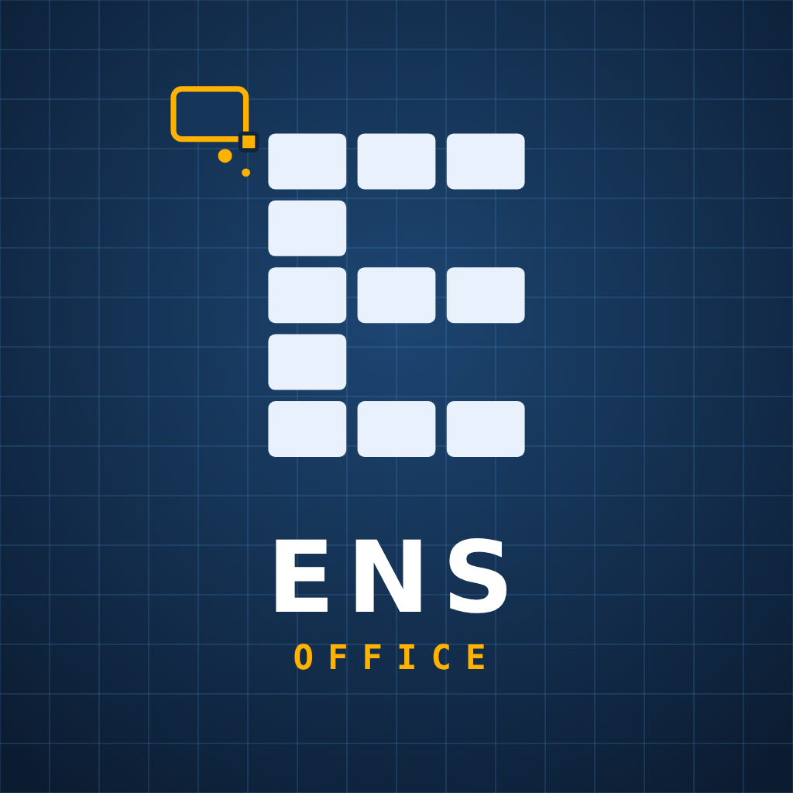

# ENS-Office
Альтернатива офисному пакету: **ENS-Text** (текстовый редактор) и **ENS-Table** (таблицы)
для РЕД ОС, других Linux, Windows, позже — Android и iOS.

Новости и обсуждение: [Telegram-канал ENS Office](https://t.me/ENS_Office).

Главные принципы: стабильность и сохранность данных, скорость на больших файлах,
привычный интерфейс в стиле Microsoft Office 2021–2024.

- [Концепция и план](docs/00-concept.md)
- [Журнал решений](docs/02-decisions.md)
- [Исследования](docs/research/)
