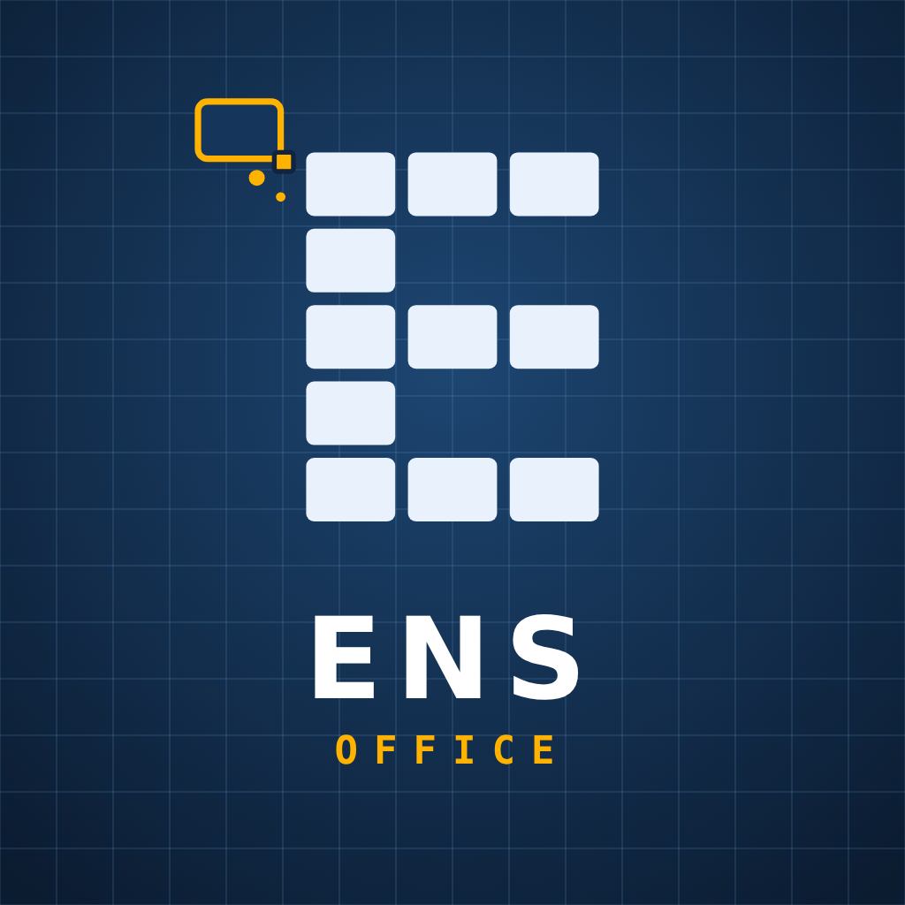

# ENS-Office
Альтернатива офисному пакету: **ENS-Text** (текстовый редактор) и **ENS-Table** (таблицы)
для РЕД ОС, других Linux, Windows, позже — Android и iOS.

Новости и обсуждение: [Telegram-канал ENS Office](https://t.me/ENS_Office).

Главные принципы: стабильность и сохранность данных, скорость на больших файлах,
привычный интерфейс в стиле Microsoft Office 2021–2024.

- [Концепция и план](docs/00-concept.md)
- [Журнал решений](docs/02-decisions.md)
- [Исследования](docs/research/)

## Лицензия

**Двойное лицензирование: GNU AGPL-3.0 или коммерческая лицензия.**

Copyright (C) 2026 Николай Сергеевич Едренников.

### Бесплатно (AGPL-3.0)

✅ Использовать, в том числе в организации
✅ Изучать и изменять исходный код
✅ Распространять копии и свои версии

При условиях:
📖 Сохранять уведомления об авторстве
🔓 Открывать исходный код при распространении изменённых версий
🌐 Предлагать исходники пользователям сетевой версии
🔄 Распространять производные под той же лицензией

**Внутреннее использование без распространения наружу не требует
открывать свои доработки.** Частным лицам и школам — всё бесплатно.

### Коммерческая лицензия

Для тех, кто встраивает ENS-Office в закрытый продукт, распространяет
изменённую версию под своими условиями или нуждается в поддержке
по договору, сертифицированных сборках и сопровождении.

📧 **n.edrennikov@yandex.ru** · подробности: [COMMERCIAL-LICENSE.md](COMMERCIAL-LICENSE.md)

### Документы

| Файл | О чём |
|---|---|
| [LICENSE](LICENSE) | Текст AGPL-3.0 |
| [NOTICE](NOTICE) | Авторство и состав продукта |
| [COMMERCIAL-LICENSE.md](COMMERCIAL-LICENSE.md) | Коммерческие условия |
| [TRADEMARK.md](TRADEMARK.md) | Названия и логотипы |
| [THIRD_PARTY_NOTICES.md](THIRD_PARTY_NOTICES.md) | Сторонние компоненты |
| [CLA.md](CLA.md) | Соглашение для участников |
| [AUTHORS.md](AUTHORS.md) | Авторы |

### Участие в проекте

Вклады принимаются после принятия [CLA.md](CLA.md) — это необходимо
для сохранения возможности двойного лицензирования. Сообщения
об ошибках и тестовые файлы CLA не требуют и очень помогают.

### О совместимости с Microsoft Office

ENS-Office не связан с Microsoft Corporation и не одобрен ею.
Названия Word, Excel, Office упомянуты только для указания
совместимости форматов. Значки — Fluent UI System Icons (MIT,
Microsoft), шрифты — свободные метрические аналоги (OFL-1.1).
Раскладка интерфейса следует привычным принципам; графика
и оформление проекта оригинальные.
